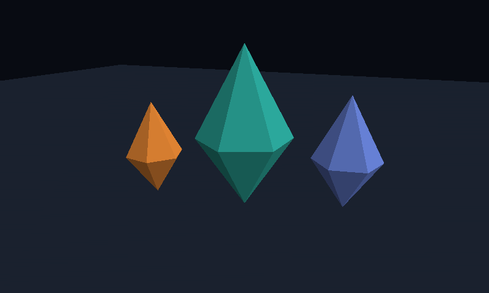

# ABE Engine

ABE is a native Rust game engine in development. Its player, editor and build tools are intended for multiple games. Game assets, domain rules, network protocols and title-specific adapters belong in each game's repository.

The core has zero third-party Cargo dependencies. The Vulkan backend calls the system loader directly and builds its shader programs as SPIR-V from Rust source.

## Run the native player

```sh
cargo run --locked --offline --release --bin abe-player
```

On Linux the player uses X11, including XWayland, and on Windows it uses Win32. Both call Vulkan directly. Click or press Space to pause, use the arrow keys to orbit, and press Escape to exit. Pass `--frames 120` after Cargo's `--` separator for a finite smoke run. The presentation path uses two reusable frame slots, per-image depth and synchronization, and a swapchain. The normal frame loop does not read pixels back to the CPU.



## Render an offscreen reference

On Linux or Windows with a Vulkan loader and driver:

```sh
cargo run --locked --offline --release --example observatory -- scene.ppm
```

The example renders a generic 3D sculpture to a Netpbm image. It uses the same camera and renderer interfaces available to game clients.

## Cook a static scene

```sh
cargo run --locked --offline --release --bin abe-build -- cook source.glb scene.abew
cargo run --locked --offline --release --bin abe-build -- inspect scene.abew
```

The cooker accepts embedded glTF 2.0 triangle meshes with float positions, optional indices, base colors and scene-node transforms. ABEW v1 stores meshes once and references them from affine instances. Unsupported codecs, skins, animation and textured base colors are reported explicitly. Games can convert authored content before cooking. The portable `abe-core` and `abe-assets` crates have no external dependencies.

[Explore the six architecture layers](docs/architecture.html) (download and open the self-contained HTML to use the selectors). [Engine milestones](docs/roadmap.md).

## Verify

```sh
cargo test --workspace --locked --offline
cargo test --locked --offline --test vulkan -- --ignored
cargo test --locked --offline --test present -- --ignored
```

The offscreen test checks depth and pixel readback. The desktop test needs a display and exercises resize, hide/restore, and presenter recreation. Linux presentation and keyboard input have been exercised on Mesa llvmpipe under Xvfb with synchronization validation. Windows is cross-built and still needs a native device run. Android has the offscreen backend only. Apple Metal and browser presentation are planned. The Vulkan ABI declarations are adapted from [Khronos Vulkan-Headers v1.3.275](https://github.com/KhronosGroup/Vulkan-Headers/tree/v1.3.275) under the license in [docs/Vulkan-Registry-LICENSE.txt](docs/Vulkan-Registry-LICENSE.txt).
